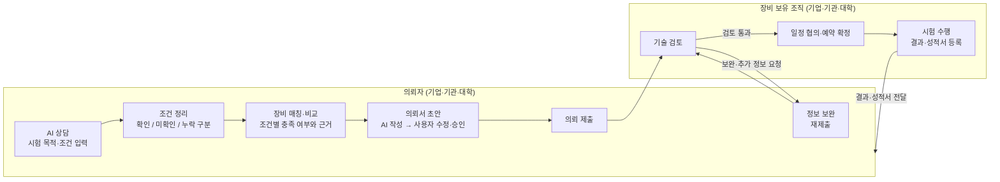
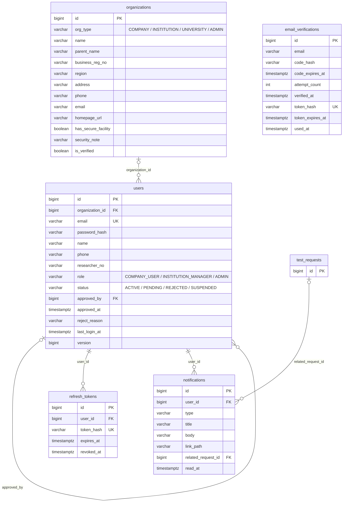
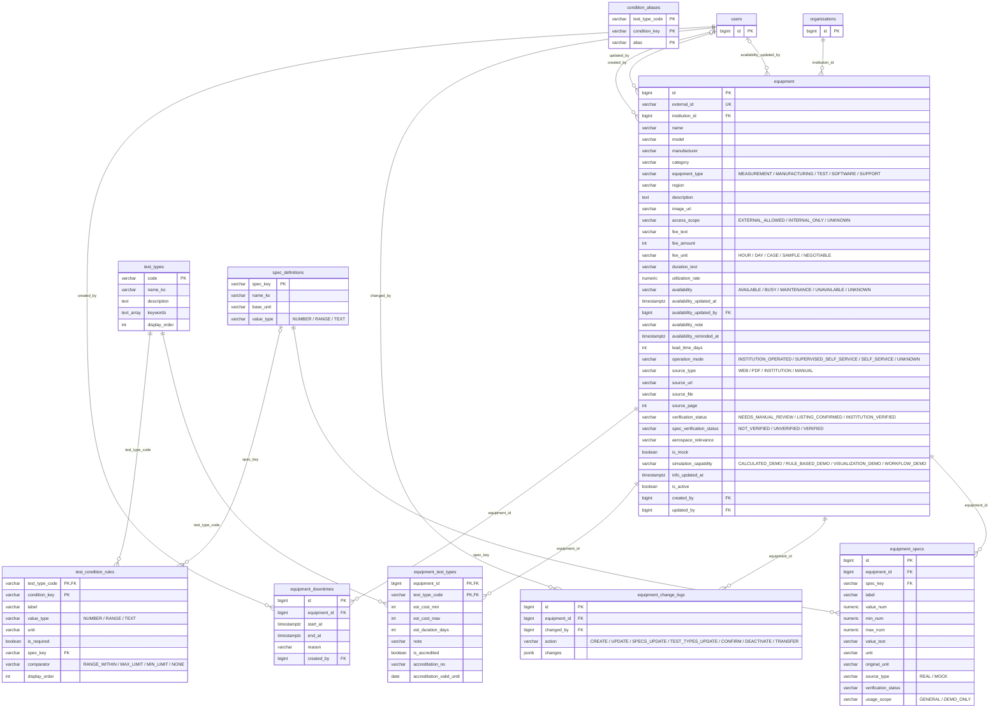
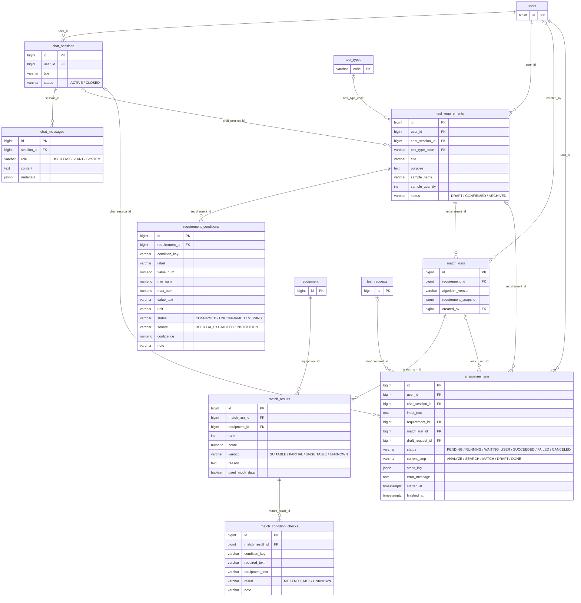
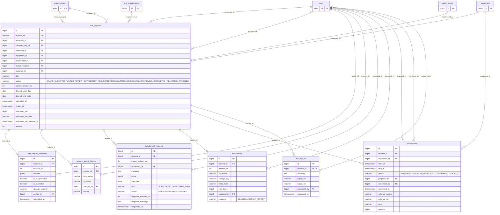
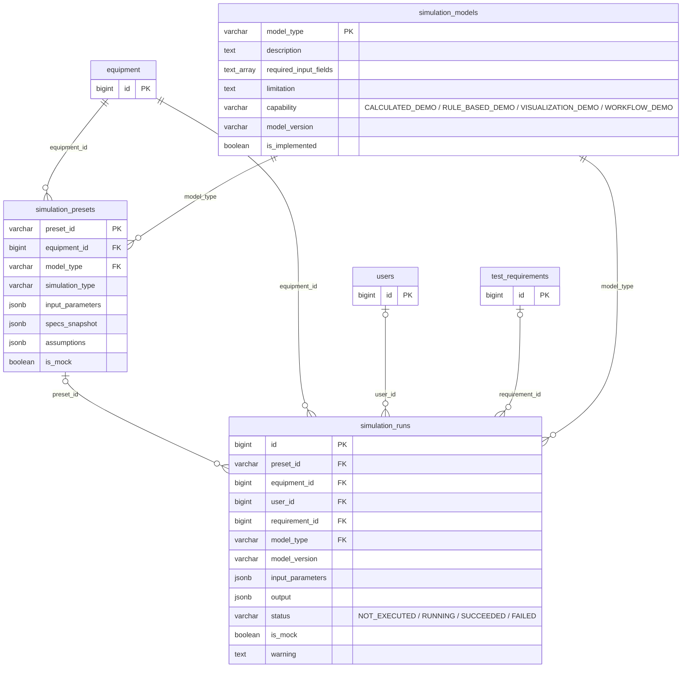
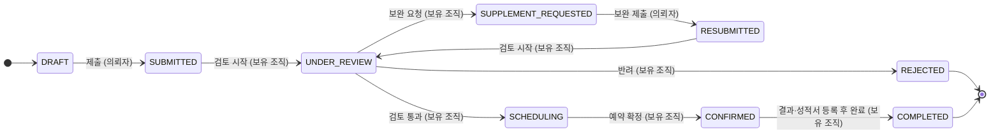

# ASTRA: 우주항공 시험장비 공동활용 플랫폼 (Backend)

> 장비 이름을 몰라도, 시험 조건만으로 맞는 시험장비를 찾고 의뢰까지 끝내는 플랫폼
>
> AI 디자인 캡스톤 7조 · 백엔드 저장소
>
> 프로젝트 기간: 2026/11/7 ~
>
> 백엔드: 윤준수 (BE-A 플랫폼 기반) · 허영재 (BE-B 의뢰 워크플로우) · 주현욱 (BE-C AI)
>
> 프론트엔드: 연지 · 홍인 (별도 저장소)

## 목차
1. [프로젝트 방향](#1-프로젝트-방향)
2. [핵심 흐름](#2-핵심-흐름)
3. [설계 원칙](#3-설계-원칙)
4. [기능과 담당](#4-기능과-담당)
5. [ERD](#5-erd)
6. [의뢰 상태 흐름](#6-의뢰-상태-흐름)
7. [기술 스택](#7-기술-스택)
8. [실행하기](#8-실행하기)
9. [코드 구조](#9-코드-구조)
10. [개발 규칙](#10-개발-규칙)
11. [문서](#11-문서)

---

## 1. 프로젝트 방향

### 해결하려는 문제
- **장비 정보가 흩어져 있다.** 우주항공 시험장비는 테크노파크, 연구원, 대학 센터 등 여러 기관에 나뉘어 있고, 공개된 정보의 형식도 기관마다 다릅니다.
- **기업은 장비 이름보다 시험 조건을 안다.** "시료 15kg, 20~2000Hz 진동시험"처럼 조건은 알아도 어떤 장비가 맞는지는 모르는 경우가 많습니다.
- **의뢰 과정에서 정보와 상태가 엇갈린다.** 접수 → 보완 요청 → 재제출 → 일정 확정을 거치는 동안 누가 무엇을 고쳤는지 추적하기 어렵습니다.

### ASTRA가 하는 일
지역 시험장비를 한곳에 모으고, **AI 상담으로 시험 조건을 정리 → 조건에 맞는 장비를 근거와 함께 비교 → 의뢰서 초안 작성 → 장비 보유 조직의 검토·보완·일정 확정 → 시험 대행과 결과·성적서 전달**까지 하나의 흐름으로 잇습니다.

**장비를 빌려주는 것이 아니라, 장비를 가진 조직이 대신 시험하고 결과값과 성적서를 보내 주는 방식입니다.** 기업·시험기관·대학 누구나 시험을 맡기거나 맡을 수 있고, 기업 ↔ 기관, 기업 ↔ 기업, 기관 ↔ 기관, 대학 ↔ 기업처럼 어느 조합이든 한 플랫폼에서 의뢰가 오갑니다. 한 조직이 어떤 의뢰에서는 의뢰자, 다른 의뢰에서는 장비 보유 조직이 됩니다.

### 기존 서비스와의 차이

연구장비를 찾는 곳은 이미 있습니다. 국가 R&D 예산으로 구축된 연구시설·장비는 과학기술정보통신부의 **ZEUS(국가연구시설장비종합정보시스템, [zeus.go.kr](https://www.zeus.go.kr))** 에서 검색하고 공동활용을 신청할 수 있고, 그 밖에는 대학·출연연·테크노파크가 각자 홈페이지로 신청을 받는 경우가 많습니다. ZEUS 는 2026년 7월 27일부터 연구 목적을 자연어로 입력하면 가까운 이용 가능 장비를 추천하고 예약까지 이어 주는 AI 검색을 시범 운영하고 있고, 12월 정식 운영을 계획하고 있습니다 ([데일리안](https://www.dailian.co.kr/news/view/1671251/), [아시아경제](https://view.asiae.co.kr/en/article/2026072710481914291), 2026-07-27 보도).

자연어 장비 검색은 ZEUS 도 제공하므로, ASTRA 는 **장비를 찾은 다음 단계**에 집중합니다.

| | ZEUS AI 검색 (보도 기준) | ASTRA |
|---|---|---|
| 대상 | 국가 R&D 예산으로 구축된 연구시설·장비 | 우주항공 시험·생산 장비. 기업·시험기관·대학이 서로 시험을 맡기고 대행함 (시연 데이터: 가상 조직 16곳, 장비 339대) |
| 찾는 방식 | 연구 목적 입력 → 가까운 이용 가능 장비 추천 | 시험 조건(시료 질량, 주파수 범위 등)을 정리하고, 시험유형별 규칙으로 장비 사양과 조건마다 충족·미충족·미확인을 판정 |
| 결과에 담기는 것 | 추천 장비와 예약 | 조건별 근거 표(요구 20~2000Hz vs 장비 5~1800Hz → 미충족), 사양·요금·기간 비교표, 시연 데이터(MOCK)·기관 확인 여부 표시 |
| 이후 흐름 | 장비 예약 | 의뢰서 초안 → 제출 → 기관 기술 검토·보완 요청 → 재제출(제출본 이력 분리) → 일정 확정 |

- 보도에는 ZEUS AI 검색의 사양 대조·조건별 판정·시험 의뢰서·기관 검토 기능에 대한 언급이 없습니다. 위 표의 ZEUS 칸은 보도 내용만 옮긴 것이고, 실제 서비스와 다를 수 있습니다.
- 시험 실무자 의견(경남 지역 문의 답변)에서 공통으로 나온 어려움은 **상세 사양 부족, 공인시험(KOLAS) 성적서 필요 여부, 일정·비용 비교, 운용 인력 지원, 보안·수출통제 협의**입니다. ASTRA 는 이 중 상세 사양 기반 비교와 일정·비용 비교를 다루고, 공인시험·운용 인력·보안 협의 정보는 보완을 검토하고 있습니다.

### 사용자

조직은 **기업**(`COMPANY`) · **시험기관**(`INSTITUTION`) · **대학**(`UNIVERSITY`) 세 유형이고, 어느 유형이든 아래 두 입장을 모두 가질 수 있습니다.

| 입장 | 하는 일 |
|---|---|
| **의뢰자** | AI 상담으로 조건 정리, 장비 검색·비교, 다른 조직 장비에 시험 의뢰, 보완 자료 제출 |
| **장비 보유 조직 구성원** | 소속 조직 장비 정보 등록·갱신, 들어온 의뢰 검토, 보완 요청, 예약 확정 |
| **플랫폼 관리자** (`ADMIN`) | 전체 권한(마스터), 회원·조직 승인, 초기 데이터 관리 |

- 권한은 역할이 아니라 **소속 조직**으로 판단합니다. 장비·받은 의뢰는 `user.organization_id == equipment.institution_id`인 회원만 다룹니다.
- 역할 `COMPANY_USER`(기업 가입) / `INSTITUTION_MANAGER`(기관·대학 가입)는 가입 유형과 기본 화면만 정합니다.
- **자기 조직이 보유한 장비에는 의뢰할 수 없고**, 매칭 추천에서도 빠집니다.
- 의뢰 목록은 `?box=SENT|RECEIVED`, 대시보드는 `?view=REQUESTER|PROVIDER`로 두 입장을 오갑니다.

로그인하지 않은 사용자는 회원가입·로그인 외에는 아무것도 볼 수 없습니다. (JWT 로그인 적용, [시연 계정](#시연-계정) 참고)

회원가입은 **이메일 인증(6자리 코드) → 가입 신청(승인 대기) → 플랫폼 관리자 승인** 순서입니다. 기업은 회사명·사업자등록번호, 기관·대학 담당자는 소속 기관·대학(목록 선택 또는 신규 입력, `orgType`으로 기관/대학 구분)을 함께 입력합니다.

### 데이터 현황
- 초기 데이터는 **전부 시연용**(`isMock=true`)입니다. 조직 16곳(기관 8·대학 4·기업 4)은 모두 가상 이름이고, 장비는 339대입니다.
  - V2 장비 71대: 공개자료로 모은 장비. 소속 기관 이름은 V8 에서 가상 이름으로 바꿨고 원래 출처 링크는 지웠습니다.
  - V8 장비 268대: 열진공·진동·EMC·만능시험기·CT·CMM 등 **실제 판매 모델**(제조사·모델명·사양은 제조사 공개자료 기준). 보유 조직·요금·가동률·가용 상태는 가상입니다. 원본은 [`docs/design/tools/equipment_catalog.json`](docs/design/tools/equipment_catalog.json)(출처 링크 포함).
- 공개자료에서 확인한 사양은 `REAL`, 추정치는 `MOCK`(`DEMO_ONLY`)으로 나눠 저장하고, 화면에 "시연용 데이터"로 표시합니다. 회원이 직접 등록한 장비·사양은 실제 데이터로 우선 사용합니다.

---

## 2. 핵심 흐름



버튼 하나로 **조건 분석 → 장비 검색 → 적합성 비교 → 의뢰서 초안**까지 자동으로 진행하는 기능(AI 자동 추진)도 있습니다. 단, 제출은 항상 사용자가 직접 확인한 뒤에 합니다.

---

## 3. 설계 원칙

| 원칙 | 구현 방식 |
|---|---|
| **AI는 돕고, 판단은 기관이 한다** | 매칭 결과에는 항상 "최종 시험 가능 여부는 기관 검토로 확정" 안내. AI 의뢰서는 초안(DRAFT)까지만 만들고 자동 제출하지 않음 |
| **매칭은 규칙으로, 설명은 AI로** | 조건-사양 비교는 `test_condition_rules`의 규칙(범위 포함, 최대값 이하 등)으로 코드가 판정. LLM은 문장에서 조건을 뽑고 추천 이유를 설명하는 데만 사용. 그래서 결과가 매번 같고 근거를 보여줄 수 있음 |
| **모르는 건 모른다고 표시한다** | 조건마다 `CONFIRMED / UNCONFIRMED / MISSING`, 매칭 결과마다 `MET / NOT_MET / UNKNOWN` |
| **누가 무엇을 바꿨는지 남긴다** | 의뢰의 현재 상태(`test_requests`)와 제출본 이력(`test_request_revisions`)을 분리하고, 상태 변경은 모두 `request_status_history`에 기록 |
| **장비 정보의 주인은 보유 조직이다** | 초기 데이터는 "보유 조직 미확인"으로 표시. 이후 등록·갱신은 그 장비를 가진 조직(기업·기관·대학)의 구성원이 직접 하고, 확인하면 `INSTITUTION_VERIFIED` |
| **시연 데이터는 시연 데이터라고 말한다** | 가상 사양은 `source_type = MOCK`, 가상 시뮬레이션은 결과마다 DEMO 경고. 실제 장비 성능처럼 표시하지 않음 |
| **중요한 규칙은 DB가 지킨다** | 같은 장비의 확정 예약 시간 겹침 금지, 의뢰당 확정 예약 1개, 의뢰당 답변 대기 보완 요청 1개를 DB 제약조건으로 강제 (동시에 요청해도 하나만 성공) |

---

## 4. 기능과 담당

### 백엔드 담당자

| 역할 | 담당자 | 맡는 것 |
|---|---|---|
| **BE-A** · 플랫폼 기반 | **윤준수** | 프로젝트 셋업, 공통 모듈(`global/`), 로그인·권한, 장비 데이터, 관리자, 대시보드 |
| **BE-B** · 의뢰 워크플로우 | **허영재** | 시험 의뢰·상태 관리, 기관 검토·보완, 예약, 알림, 가상 시뮬레이션 |
| **BE-C** · AI | **주현욱** | LLM 연동, AI 상담, 조건 분석, 매칭, 의뢰서 초안, 자동 추진 |

### 프론트엔드 담당자

프론트엔드는 **연지**, **홍인**이 맡고 별도 저장소에서 개발합니다. 백엔드 API는 Swagger UI와 [`docs/api-spec.md`](docs/api-spec.md)를 기준으로 연동하고, API가 완성되기 전에는 명세의 예시 응답으로 목서버(MSW)를 만들어 먼저 개발합니다.

### 기능별 담당

| # | 기능 | 패키지 | 담당 |
|---|---|---|---|
| 1 | 장비 통합 검색 | `equipment` | BE-A |
| 2 | 장비 상세 정보 (사양, 보유기관, 이용조건, 가동률, 정보 갱신일) | `equipment` | BE-A |
| 3 | 시험항목·자연어 검색 | `testtype`, `equipment` | BE-A |
| 4 | 시험 정보 안내 (가능 기관, 예상 비용, 소요기간) | `testtype` | BE-A |
| 5 | AI 챗봇 상담 | `chat`, `llm` | BE-C |
| 6 | AI 시험조건 분석 (누락 정보 확인) | `requirement` | BE-C |
| 7 | AI 장비 매칭·비교 | `matching` | BE-C |
| 8 | AI 시험 의뢰서 초안 (생성은 `llm`, 저장은 `TestRequestService.createDraft`) | `llm`, `request` | BE-C (생성), BE-B (저장) |
| 9 | 온라인 시험 의뢰 | `request` | BE-B |
| 10 | 기관 검토·정보 보완 | `review` | BE-B |
| 11 | 시험 예약 검토·확정 | `reservation` | BE-B |
| 12 | 중복 장비 조회 | `equipment` | BE-A |
| 13 | AI 자동 추진 | `aipipeline` | BE-C |
| 14 | 메인 대시보드 | `dashboard`, `notification` | BE-A, BE-B |
| 15 | 가상 시뮬레이션 (시연용) | `simulation` | BE-B |
| - | 회원가입·로그인·권한, 관리자 승인, 기관 장비 관리 | `auth`, `user`, `organization`, `admin`, `equipment` | BE-A |

API 92개의 상세 명세와 우선순위(P0 시연 필수 / P1 / P2)는 [`docs/api-spec.md`](docs/api-spec.md), 담당자별 할 일은 [`docs/team-guide.md`](docs/team-guide.md) 5번에 있습니다.

---

## 5. ERD

테이블 32개. 아래 그림은 `docs/design/schema.sql`에서 자동 생성했습니다. 도메인별 상세는 펼쳐서 보세요 (`created_at`, `updated_at` 컬럼은 생략).

<!-- ERD:START (python docs/design/tools/schema_to_mermaid.py 출력으로 교체) -->

#### 전체 관계도

```mermaid
erDiagram
    organizations |o--o{ users : ""
    users ||--o{ refresh_tokens : ""
    test_types ||--o{ test_condition_rules : ""
    spec_definitions |o--o{ test_condition_rules : ""
    organizations ||--o{ equipment : ""
    users |o--o{ equipment : ""
    equipment ||--o{ equipment_specs : ""
    spec_definitions ||--o{ equipment_specs : ""
    equipment ||--o{ equipment_change_logs : ""
    users ||--o{ equipment_change_logs : ""
    equipment ||--o{ equipment_test_types : ""
    test_types ||--o{ equipment_test_types : ""
    equipment ||--o{ equipment_downtimes : ""
    users ||--o{ equipment_downtimes : ""
    users ||--o{ chat_sessions : ""
    chat_sessions ||--o{ chat_messages : ""
    users ||--o{ test_requirements : ""
    chat_sessions |o--o{ test_requirements : ""
    test_types |o--o{ test_requirements : ""
    test_requirements ||--o{ requirement_conditions : ""
    test_requirements ||--o{ match_runs : ""
    users |o--o{ match_runs : ""
    match_runs ||--o{ match_results : ""
    equipment ||--o{ match_results : ""
    match_results ||--o{ match_condition_checks : ""
    users ||--o{ test_requests : ""
    organizations |o--o{ test_requests : ""
    equipment ||--o{ test_requests : ""
    test_requirements |o--o{ test_requests : ""
    match_results |o--o{ test_requests : ""
    test_requests ||--o{ test_request_revisions : ""
    users ||--o{ test_request_revisions : ""
    test_requests ||--o{ request_status_history : ""
    users ||--o{ request_status_history : ""
    test_requests ||--o{ supplement_requests : ""
    users ||--o{ supplement_requests : ""
    test_requests ||--o{ attachments : ""
    users ||--o{ attachments : ""
    test_requests ||--o{ reservations : ""
    equipment ||--o{ reservations : ""
    users ||--o{ reservations : ""
    users ||--o{ ai_pipeline_runs : ""
    chat_sessions |o--o{ ai_pipeline_runs : ""
    test_requirements |o--o{ ai_pipeline_runs : ""
    match_runs |o--o{ ai_pipeline_runs : ""
    test_requests |o--o{ ai_pipeline_runs : ""
    equipment ||--o{ simulation_presets : ""
    simulation_models ||--o{ simulation_presets : ""
    simulation_presets |o--o{ simulation_runs : ""
    equipment ||--o{ simulation_runs : ""
    users |o--o{ simulation_runs : ""
    test_requirements |o--o{ simulation_runs : ""
    simulation_models ||--o{ simulation_runs : ""
    users ||--o{ notifications : ""
    test_requests |o--o{ notifications : ""
    test_requests ||--o{ test_results : ""
    users ||--o{ test_results : ""
```



<details>
<summary><b>사용자 · 조직</b> (5개 테이블)</summary>



</details>

<details>
<summary><b>장비 · 시험유형</b> (9개 테이블)</summary>



</details>

<details>
<summary><b>AI 상담 · 시험조건 · 매칭 · 자동 추진</b> (8개 테이블)</summary>



</details>

<details>
<summary><b>시험 의뢰 · 검토 · 보완 · 예약 · 결과</b> (7개 테이블)</summary>



</details>

<details>
<summary><b>가상 시뮬레이션</b> (3개 테이블)</summary>



</details>

<!-- ERD:END -->

- 전체 컬럼·제약조건의 기준은 [`docs/design/schema.sql`](docs/design/schema.sql)입니다.
- dbdiagram.io용 ERD: [`docs/design/erd.dbml`](docs/design/erd.dbml)
- 스키마를 바꾸면 `python docs/design/tools/schema_to_mermaid.py`로 위 그림을 다시 만듭니다.

---

## 6. 의뢰 상태 흐름



`DRAFT`부터 `SCHEDULING`까지는 의뢰자가 언제든 취소(`CANCELED`)할 수 있습니다. 의뢰자·보유 조직은 조직 유형이 아니라 그 의뢰에서의 입장입니다 (기업이 보유 조직, 대학이 의뢰자일 수도 있음). 상태 변경은 모두 상태 갱신 + 이력 저장 + 상대방 알림을 한 트랜잭션으로 처리합니다.

- 제출할 때 실사용자·회계 담당자(이름 + 연락처)가 있어야 합니다. 검토 중에 보유 조직이 **추가 정보 요청**(`kind=ADDITIONAL_INFO`)으로 책임자명·성적서 종류·시료 처리·청구 방법을 한 번 더 받고, **예상 이용료**는 보유 조직이 직접 적습니다.
- 일정이 확정(`CONFIRMED`)된 뒤 보유 조직이 시험 결과(요약, 성적서 번호, 링크)를 등록해야 `COMPLETED` 로 넘길 수 있습니다. 성적서 파일(pdf 등, 20MB까지)도 올릴 수 있고, 의뢰자가 내려받습니다.
- 제출할 때 이용 희망 기간도 필수입니다.

---

## 7. 기술 스택

| 구분 | 사용 |
|---|---|
| 언어 / 프레임워크 | Java 21 (LTS), Spring Boot 4.1.2 |
| 빌드 | Gradle 9.8.2 (Wrapper) |
| DB | PostgreSQL 16, Flyway, Spring Data JPA |
| 보안 | Spring Security 7, JWT (jjwt 0.13.0) |
| API 문서 | springdoc-openapi 3.2.0 (Swagger UI) |
| AI | Anthropic Java SDK 3.6.0 (`claude-opus-5-5`) |
| 테스트 | JUnit 5, Testcontainers (PostgreSQL 16) |
| CI | GitHub Actions (PR·`main` 푸시마다 빌드 + 테스트) |

---

## 8. 실행하기

**준비물**: JDK 21, Docker Desktop (켜져 있어야 함)

```bash
git clone https://github.com/capstoneastra/Astra_Back.git
cd Astra_Back
cp .env.example .env        # 필요한 값 채우기 (DB 는 기본값 그대로 두면 됨)
./gradlew bootRun           # Windows: gradlew.bat bootRun
```

- `bootRun`을 하면 `compose.yaml`의 PostgreSQL 16이 자동으로 뜨고, Flyway가 `V1__init.sql`(테이블), `V2__seed.sql`(초기 데이터), `V3__demo_accounts.sql`(시연 계정), `V4__email_verifications.sql`(가입 이메일 인증), `V5__fill_institution_region.sql`(지역이 비어 있던 기관·장비 31대에 '진주' 채움), `V6__equipment_integrity_and_availability.sql`(사양 사전·기준 단위·가용성·정비·공인·운용·보안), `V7__university_org_type.sql`(조직 유형에 대학 추가), `V8__mock_organizations_and_equipment.sql`(가상 조직·시연 장비 268대·시연 계정 2개), `V9`(시연 계정 비밀번호), `V10`·`V11`(회원·예약 동시 수정 방지 version), `V12`(국가연구자번호), `V13`(추가 정보 요청 종류), `V14`(예상 이용료), `V15`(시험 결과·성적서), `V16`(첨부파일 종류: 일반 / 성적서)을 적용합니다.
- 첨부파일·성적서 파일은 서버 디스크 `astra.storage.dir`(기본 `./data/uploads`, git 제외)에 저장합니다. 시연 서버(`compose.prod.yaml`)는 `astra-prod-uploads` 볼륨에 저장해 재배포해도 남습니다.
- Swagger UI: http://localhost:8080/swagger-ui.html
- 헬스체크: http://localhost:8080/actuator/health
- IntelliJ: **Project SDK와 Gradle JVM을 모두 21**로 맞춘 뒤 `AstraApplication`을 실행합니다.
- DB를 처음부터 다시 만들려면: `docker compose down -v` 후 다시 실행합니다.
- `.env`의 `JWT_SECRET`이 비어 있으면 임시 키로 실행됩니다(재시작하면 로그인이 풀림). 32자 이상 아무 문자열을 넣어 두면 편합니다.
- **FE 연동(CORS)**: 브라우저에서 이 서버를 부를 수 있는 프론트 주소는 `.env`의 `CORS_ALLOWED_ORIGINS`입니다. 비워 두면 `http://localhost:5173`(Vite 기본)이고, 다른 주소는 쉼표로 추가합니다(`http://localhost:*` 패턴 가능). 브라우저 콘솔에 "blocked by CORS policy"가 뜨면 이 값을 확인하세요.
- `.env`의 `MAIL_HOST`가 비어 있으면 가입 인증 메일을 보내지 않고 **서버 로그에 인증 코드**를 출력합니다 (`[메일 미발송: 로그 출력]`). 실제 발송은 `.env.example`의 SMTP 항목을 채웁니다. 시연 날에는 `MAIL_LOG_CODE=true`로 실행하면 메일을 보낸 뒤 서버 로그에도 `[인증 코드]`가 남아, 일회용 메일이 늦을 때 쓸 수 있습니다 (평소에는 끄기).

### 시연 서버 실행 (Docker)

시연 서버(VM)나 다른 PC에서 DB와 앱을 한 번에 띄울 때 씁니다. 로컬 개발은 위의 `./gradlew bootRun`을 그대로 씁니다.

```bash
cp .env.example .env      # DB_PASSWORD, JWT_SECRET(32자 이상) 꼭 채우기. MAIL_*, CORS_ALLOWED_ORIGINS 는 필요에 따라
docker compose -f compose.prod.yaml up -d --build     # 처음 또는 코드가 바뀌었을 때
docker compose -f compose.prod.yaml logs -f app       # 앱 로그
docker compose -f compose.prod.yaml down              # 중지 (DB 데이터 유지, 지우려면 -v)
```

- `Dockerfile`: JDK 21로 jar를 만들고 JRE 21 이미지에서 root가 아닌 사용자로 실행합니다. 테스트는 CI가 맡아서 이미지 빌드 때는 건너뜁니다.
- `compose.prod.yaml`: PostgreSQL 16(포트를 밖으로 열지 않음) + 앱(`prod` 프로필, 헬스체크). `DB_PASSWORD`·`JWT_SECRET`이 없으면 실행되지 않습니다. `.env`의 `DB_URL`은 로컬용이라 compose가 `db` 서비스 주소로 바꿔 넣습니다.
- 운영 설정(`application-prod.yml`): 헬스체크 세부 정보 숨김, 인증 코드 로그 끔, Swagger는 기본으로 켜 둠(외부 공개 시 `SWAGGER_ENABLED=false`).
- `.env`에서 true/false 값(`SWAGGER_ENABLED`, `MAIL_LOG_CODE`)은 빈 값으로 두지 마세요. 빈 값이면 서버가 뜨지 않습니다.
- 시연 순서와 점검표: [`docs/demo-scenario.md`](docs/demo-scenario.md)

### 시연 계정

`/auth/**`(로그아웃 제외), Swagger, 헬스체크 외에는 모두 로그인이 필요합니다. 시연 계정 비밀번호는 모두 **`1234`** 입니다 (V18 에서 이메일 `@astra.kr`·비밀번호 변경, 시연 전용 계정이라 공개해도 되는 값). 실제 운영 계정에는 쓰지 마세요.

| 이메일 | 역할 | 소속 | 상태 |
|---|---|---|---|
| `admin@astra.kr` | ADMIN | ASTRA 플랫폼 운영 | ACTIVE |
| `company@astra.kr` | COMPANY_USER | 가상 A기업 | ACTIVE |
| `company2@astra.kr` | COMPANY_USER | 미르항공정밀 (장비 44대 보유 기업) | ACTIVE |
| `lab1@astra.kr` | INSTITUTION_MANAGER | 미리내우주환경시험센터 (기관, 장비 48 보유) | ACTIVE |
| `lab2@astra.kr` | INSTITUTION_MANAGER | 다온신뢰성시험센터 (기관) | ACTIVE |
| `univ@astra.kr` | INSTITUTION_MANAGER | 늘해랑대학교 항공우주공동기기원 (대학, 장비 55대) | ACTIVE |
| `pending@astra.kr` | INSTITUTION_MANAGER | 가람재료시험연구원 (기관) | PENDING (로그인 시 403, 승인 시연용) |

조직 이름은 모두 가상입니다. `company`(장비 없이 의뢰만 하는 기업)와 `company2`·`univ`로 기업 ↔ 대학 ↔ 기관 사이의 의뢰를 시연할 수 있습니다.

Swagger에서 호출하기: `POST /api/v1/auth/login`으로 로그인 → 응답의 `accessToken`을 복사 → 오른쪽 위 **Authorize**에 붙여넣기.

### 프론트 연동·시연 데이터

- 연동 방법과 프론트가 맞춰야 할 점: [`docs/frontend-integration.md`](docs/frontend-integration.md)
- 새 DB 로 서버를 띄운 뒤 `python docs/tools/seed_demo_requests.py` 를 한 번 실행하면 여러 상태의 시연 의뢰가 실제 API 로 만들어집니다 (모든 단계가 성공하면 백엔드 전체 흐름 점검도 됨)
- 프론트가 새 필수 칸을 만들기 전에 연동한다면 `.env` 에 `ASTRA_RULES_STRICT=false` (회의 결정 필수 검사 3가지를 잠시 끔)

### 테스트

```bash
./gradlew test
```

Testcontainers가 테스트 전용 PostgreSQL 16을 띄워 실제 DB로 검증합니다 (Docker 필요).

| 테스트 | 확인하는 것 |
|---|---|
| `DatabaseSchemaTest` | 마이그레이션 적용, 초기 데이터 개수(조직 유형별·V2/V8 장비·시연 데이터 표시), 조건 규칙의 사양 키 존재, 중복 예약 방지, 의뢰당 확정 예약 1개, 의뢰당 답변 대기 보완 요청 1개 |
| `ApiConventionTest` | 공통 실패 응답 형식, Swagger·헬스체크 접근 |
| `SecurityRequireLoginTest` | 비로그인 `401 AUTH_REQUIRED`, 만료 토큰 `401 TOKEN_EXPIRED`, 위조·refresh 토큰 거부, 로그아웃은 로그인 필요 |
| `AuthFlowTest` | 이메일 인증(코드 틀림·만료·재발송 제한·토큰 1회 사용) → 가입(모두 PENDING·관리자 불가·사업자번호 형식) → 승인 → 로그인 → 내 정보 → 재발급(쓴 토큰 폐기) → 로그아웃, 시연 계정 seed |
| `EquipmentApiTest` | 장비 목록·검색(q·지역·기관·유형·외부이용·MOCK 필터, 정렬)·상세(REAL 먼저), 유사·중복·비교, 시험유형 목록·시험 정보 안내, 기관 목록·상세, BE-C용 `EquipmentQueryService` (seed 실제 값으로 검증) |
| `AdminUserApprovalTest` | 관리자 회원 목록(필터·정렬·페이지), 승인(조직도 승인)·거절(로그인 시 사유 표시)·정지/해제(재발급 차단), 상태 오류 409, 권한 403·404 |
| `EquipmentManageTest` | 장비 등록(ASTRA-EQ 외부 id)·수정·REAL 사양 교체(MOCK 유지)·시험유형·확인·비활성화·변경 이력, 갱신 필요 표시, 다른 조직 403, 관리자 소속 변경, 기업의 장비 등록·관리와 기관 목록 노출 |
| `AdminUserApprovalTest` (추가) | 정지하면 이미 받은 access 토큰도 다음 요청부터 403, 해제하면 바로 통과, 계정 없는 토큰 401 |
| `SseAsyncDispatchTest` | 로그인이 필요한 SSE(스트리밍) 응답이 끝까지 전달되는지 (비동기 재요청을 보안 설정이 막지 않는지), 비로그인 SSE 는 401 |
| `CorsTest`, `CorsConfigTest` | 프론트 주소 사전 요청(preflight) 허용·다른 주소 거절, 401 응답에도 CORS 헤더, `CORS_ALLOWED_ORIGINS` 해석(쉼표·패턴·빈 값이면 기본 주소) |
| `DemoScenarioTest` | 시연 시나리오(위성 전장품 15kg, 20~2000Hz 진동시험) 중 BE-A 단계를 순서대로: 가입 → 승인 → 검색 → 상세·비교 → 기관 장비 확인 → 대시보드 |
| `DashboardSearchApiTest` | 대시보드 장비 통계·요약(의뢰 0건일 때 0·빈 목록, BE-B 연결 여부 `dataAvailable`, `view=REQUESTER\|PROVIDER` 전환), 시연 문장 자연어 검색 해석(진동시험·15kg·20~2000Hz)·지역 필터 |
| `AdminOrganizationTest` | 관리자 조직 목록(필터·정렬)·기관·대학 직접 등록·승인·수정, 이름 중복 409, 권한 403 |
| `AccessGuardTest` | 권한 체크 유틸: ADMIN 마스터, 장비·받은 의뢰는 소속 조직만(역할 무관), 개인 데이터는 본인만 |
| `RequestWorkflowTest` | 시연 11~16단계 (BE-B): 의뢰 생성·작업본 저장(version 충돌 409)·제출 → 기관 접수함·대시보드 → 검토·보완 요청(중복 409) → 보완 제출(필수 항목 누락 400, 제출본 2번·diff) → 통과 → 일정 제안·확정(중복 확정·시간 겹침 409, 맞닿는 시간 허용) → 상태 이력·완료, 취소 시 제안 정리, 알림 읽음, SIM-0048 가상 시뮬레이션. **조직 간 공유**: 기관 → 기업 장비, 대학 ↔ 기업 의뢰를 끝까지, 보낸/받은 의뢰 구분, 자기 조직 장비 의뢰 차단 |

---

## 9. 코드 구조

```
src/main/java/kr/astra/
├── global/         공통: 응답 형식, 에러 코드, 예외 처리, 보안·Swagger 설정, 메일 발송, BaseTimeEntity   ← BE-A 윤준수 (모두 사용)
├── auth/ user/ organization/ admin/ equipment/ testtype/ dashboard/                   ← BE-A 윤준수
├── request/ review/ reservation/ notification/ simulation/                           ← BE-B 허영재
└── chat/ requirement/ matching/ aipipeline/ llm/                                     ← BE-C 주현욱
```

- 각 도메인은 `controller / service / repository / entity / dto`로 나뉩니다. 각 패키지의 `package-info.java`에 담당자와 역할이 적혀 있습니다.
- `*/entity/`에는 DB의 CHECK 제약과 값이 1:1로 맞는 enum 29개가 미리 들어 있습니다. 새로 만들지 말고 이걸 씁니다.
- 담당자끼리 주고받는 내부 인터페이스는 이름과 입출력만 정의되어 있고, 구현은 각 담당자가 합니다.

| 인터페이스 | 구현 | 사용 |
|---|---|---|
| `equipment.service.EquipmentQueryService` | BE-A | BE-C (매칭) |
| `requirement.service.RequirementService` | BE-C | BE-B (의뢰서) |
| `request.service.TestRequestService` | BE-B | BE-C (AI 초안·자동 추진) |
| `notification.service.NotificationService` | BE-B | 전원 |
| `global.security.CurrentUser` | BE-A (JWT 필터에서 생성) | 전원 |
| `global.security.AccessGuard` | BE-A (권한 체크 유틸) | 전원 |

권한 체크 예시 (ADMIN은 모두 통과, 실패하면 `403 FORBIDDEN`):

```java
@GetMapping("/test-requests/{id}")
public ApiResponse<RequestDetail> detail(@AuthenticationPrincipal CurrentUser user, @PathVariable Long id) {
    TestRequest r = ...;
    AccessGuard.requireOwnerOrInstitution(user, r.getRequesterId(), r.getInstitutionId()); // 의뢰자 또는 장비 보유 조직 구성원
    ...
}
// AccessGuard.requireInstitution(user, equipment.getInstitutionId())  장비 보유 조직 구성원만 (기업·기관·대학, 역할 무관)
// AccessGuard.requireOwner(user, session.getUserId())                 본인 데이터만
// @PreAuthorize("hasRole('INSTITUTION_MANAGER')")                     역할만 확인 (ADMIN 자동 통과)
```

### 현재 상태
- ✅ 프로젝트 뼈대, 공통 모듈, DB 스키마·초기 데이터, 테스트, CI
- ⏳ 각 도메인의 Entity·API 구현 (담당자별 진행, [`docs/team-guide.md`](docs/team-guide.md) 주차별 계획 참고)
- ✅ 회원가입·로그인·JWT 인증·권한 체크(`AccessGuard`)·시연 계정 (BE-A). `/auth/**` 외 API는 로그인 필요
- ✅ 가입 이메일 인증(6자리 코드) + 기업·기관 모두 관리자 승인 후 이용, 관리자 회원 목록·승인·거절 (BE-A)
- ✅ 장비 목록·검색·상세, 시험유형 목록·시험 정보 안내, 기관 목록·상세, 매칭용 `EquipmentQueryService` 구현 (BE-A)
- ✅ 기관 장비 관리(등록·수정·사양·시험유형·비활성화·확인·변경 이력), 유사·중복 장비·비교, 관리자 회원 정지·조직 관리·장비 이관 (BE-A)
- ✅ 대시보드(장비 통계·역할별 요약), 자연어 검색(키워드 해석, BE-C 추출기 연결 준비), 90일 경과 장비 알림 (BE-A). 의뢰·상담 칸은 BE-B·BE-C 구현 후 자동 반영
- ✅ 시험 의뢰 상태머신(상태 전이표 §11, 상태 갱신·이력·알림 한 트랜잭션)·작성·제출·취소·제출본 이력/diff, 기관 검토·보완 요청·보완 제출·통과·반려·완료, 예약 제안·대안·확정·취소(중복 예약 이중 방어)·장비 달력, 알림, 가상 시뮬레이션(계산형 9종·규칙형 4종, DEMO 경고) (BE-B). `TestRequestService`·`NotificationService`·`RequestDashboardQuery` 구현으로 대시보드 의뢰 칸·가입 승인 알림·장비 갱신 알림 동작. 첨부파일(P2)은 저장소 결정 후
- ✅ CORS 설정 (프론트 주소는 `CORS_ALLOWED_ORIGINS`, 기본 `http://localhost:5173`) (BE-A)
- ✅ Dockerfile·운영용 compose(`compose.prod.yaml`)·운영 설정, 시연 시나리오 점검표(`docs/demo-scenario.md`) (BE-A). 로컬에서 운영 구성 실행 확인
- ✅ 기업·기관·대학 간 장비 공유로 확장: 대학 유형, 조직 소속 기준 권한, 기업 장비 등록, 기관·대학의 의뢰, 자기 조직 장비 의뢰 차단, 보낸/받은 의뢰·의뢰자/보유 조직 대시보드 전환, 가상 조직·실제 모델 시연 장비 268대 (V7·V8)
- ⏳ 배포(VM), 통합 테스트(BE-B·BE-C 단계 연결) (6주차)

---

## 10. 개발 규칙

자세한 내용은 [`docs/team-guide.md`](docs/team-guide.md)를 봅니다.

- **브랜치**: `main` 하나만 씁니다. `main`에서 `feature/#이슈번호-작업내용`으로 따서 작업하고 `main`으로 PR을 올립니다. CI 통과 + 리뷰 1명 승인 후 **Create a merge commit**(일반 병합)으로 병합합니다. Squash merge는 쓰지 않습니다. 병합 후 같은 브랜치를 계속 쓰려면 `git fetch origin && git merge origin/main`. 발표·중간점검 버전은 태그(`v0.1-midterm` 등)로 표시합니다.
- **커밋**: `타입: 내용` (예: `feat: 장비 목록 검색 API 추가`, `fix:`, `refactor:`, `docs:`, `chore:`)
- **API 경로**: 컨트롤러에는 [`docs/api-spec.md`](docs/api-spec.md)의 경로를 그대로 씁니다. `/api/v1`은 자동으로 붙습니다.
- **응답**: `ApiResponse.ok(data)`로 감싸서 반환하고, 실패는 `throw new BusinessException(ErrorCode.XXX)`로 던집니다. 에러 코드를 추가하면 api-spec.md §0-3도 같이 수정합니다.
- **DB 변경**: 이미 병합된 마이그레이션 파일은 절대 수정하지 않습니다. 새 파일 `V3__설명.sql`을 추가하고, 번호는 채팅으로 먼저 선점합니다. `docs/design/schema.sql`과 README의 ERD도 같은 PR에서 갱신합니다.
- **Entity**: `ddl-auto=validate`라서 Entity와 테이블이 다르면 서버가 뜨지 않습니다. 컬럼은 `docs/design/schema.sql`과 정확히 맞춥니다.
- **제약 위반 처리**: 예약 겹침 같은 DB 제약 위반은 `saveAndFlush()` 후 `DbConstraints.violates(e, ...)`로 구분해서 409로 바꿉니다.
- **비밀값**: `.env`, API 키, 비밀번호는 절대 커밋하지 않습니다.

---

## 11. 문서

| 문서 | 내용 |
|---|---|
| [`docs/api-spec.md`](docs/api-spec.md) | API 명세, 에러 코드, 매칭 규칙, 의뢰 상태 전이표 |
| [`docs/demo-scenario.md`](docs/demo-scenario.md) | 시연 시나리오 점검표 (단계별 담당·API·기대 결과·확인) |
| [`docs/work-log-be-a.md`](docs/work-log-be-a.md) | BE-A 작업 기록 |
| [`docs/work-log-be-b.md`](docs/work-log-be-b.md) | BE-B 작업 기록 (구조, 다른 담당자에게 알릴 것, 정해야 할 것) |
| [`docs/team-guide.md`](docs/team-guide.md) | 기술 스택, 협업 규칙, 담당자별 API·주차별 계획 |
| [`docs/design/schema.sql`](docs/design/schema.sql) | 전체 테이블 설계 (32개, V15) |
| [`docs/design/data-dictionary.md`](docs/design/data-dictionary.md) | 컬럼·상태·단위의 의미와 변경 책임 |
| [`docs/backend-hardening-handoff.md`](docs/backend-hardening-handoff.md) | 보완 전 수치, V6 변경 계약, 팀 공지 필요 사항과 검증 결과 |
| [`docs/design/erd.dbml`](docs/design/erd.dbml) | ERD (dbdiagram.io에 붙여넣기) |
| [`docs/design/seed.sql`](docs/design/seed.sql) | 초기 데이터 (`docs/design/tools/json_to_seed.py`로 생성) |
| [`docs/design/tools/equipment_catalog.json`](docs/design/tools/equipment_catalog.json) | V8 시연 장비 원본 (실제 모델·사양·출처). `gen_v8.py`로 V8 SQL 생성 |
