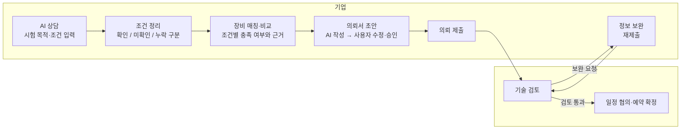
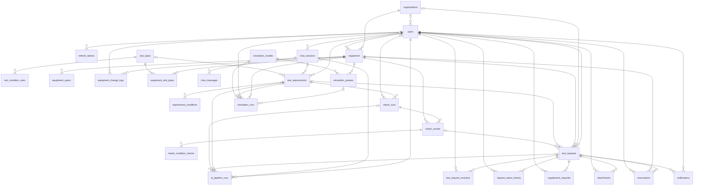
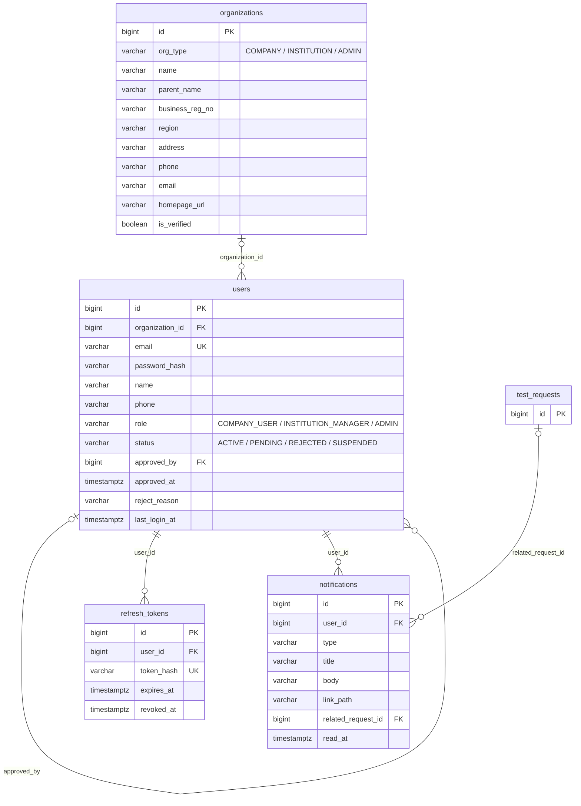
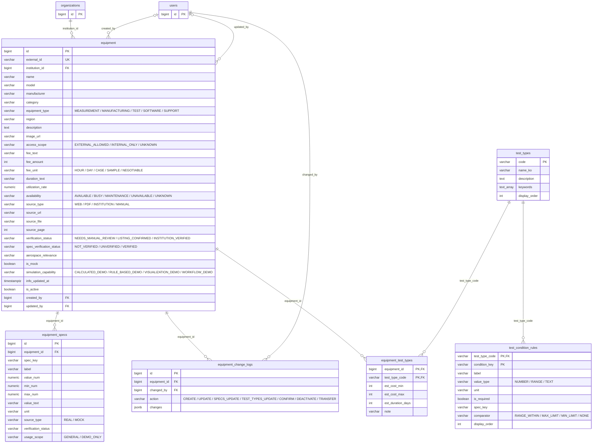
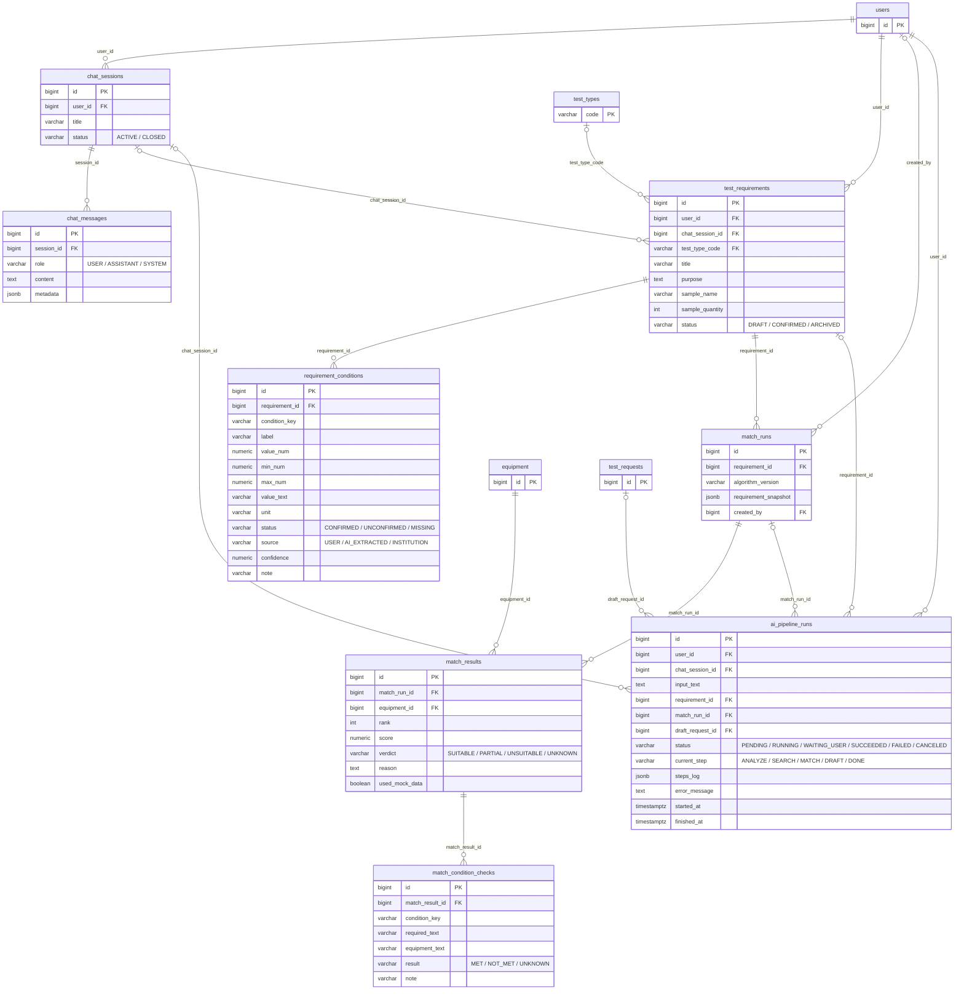
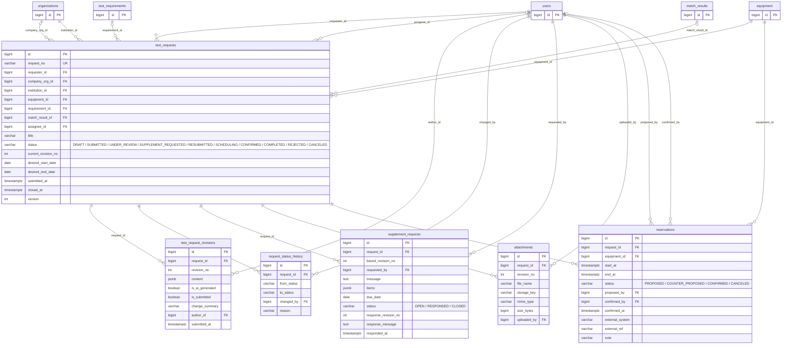
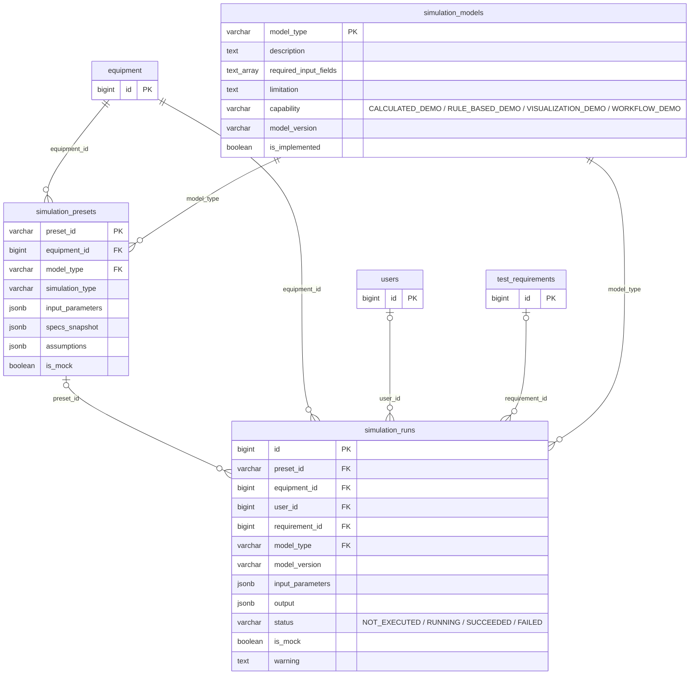
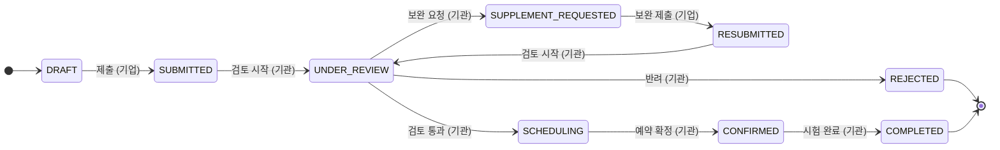

# ASTRA — 우주항공 시험장비 공동활용 플랫폼 (Backend)

> 장비 이름을 몰라도, 시험 조건만으로 맞는 시험장비를 찾고 의뢰까지 끝내는 플랫폼
>
> AI 디자인 캡스톤 7조 · 백엔드 저장소
>
> 프로젝트 기간: 2026/11/7 ~
>
> 백엔드: 윤준수 (BE-A 플랫폼 기반) · 허영재 (BE-B 의뢰 워크플로우) · 주현욱 (BE-C AI)
>
> 프론트엔드: 연지 · 홍인 (별도 저장소)

## 목차
1. [프로젝트 소개](#1-프로젝트-소개)
2. [사용자와 권한](#2-사용자와-권한)
3. [주요 기능](#3-주요-기능)
4. [핵심 흐름과 시연 시나리오](#4-핵심-흐름과-시연-시나리오)
5. [AI 활용 방식](#5-ai-활용-방식)
6. [설계 원칙](#6-설계-원칙)
7. [초기 데이터](#7-초기-데이터)
8. [ERD](#8-erd)
9. [의뢰 상태 흐름](#9-의뢰-상태-흐름)
10. [API 개요](#10-api-개요)
11. [기술 스택](#11-기술-스택)
12. [실행하기](#12-실행하기)
13. [코드 구조](#13-코드-구조)
14. [개발 일정과 진행 상황](#14-개발-일정과-진행-상황)
15. [개발 규칙](#15-개발-규칙)
16. [팀](#16-팀)
17. [문서](#17-문서)

---

## 1. 프로젝트 소개

### 해결하려는 문제
- **장비 정보가 흩어져 있다.** 우주항공 시험장비는 테크노파크, 연구원, 대학 센터 등 여러 기관에 나뉘어 있고, 공개된 정보의 형식도 기관마다 다릅니다.
- **기업은 장비 이름보다 시험 조건을 안다.** "시료 15kg, 20~2000Hz 진동시험"처럼 조건은 알아도 어떤 장비가 맞는지는 모르는 경우가 많습니다.
- **의뢰 과정에서 정보와 상태가 엇갈린다.** 접수 → 보완 요청 → 재제출 → 일정 확정을 거치는 동안 누가 무엇을 고쳤는지 추적하기 어렵습니다.

### ASTRA가 하는 일
지역 시험장비를 한곳에 모으고, **AI 상담으로 시험 조건을 정리 → 조건에 맞는 장비를 근거와 함께 비교 → 의뢰서 초안 작성 → 기관 검토·보완·예약**까지 하나의 흐름으로 잇습니다.

### 누구에게 어떤 도움이 되나

| 사용자 | 달라지는 점 |
|---|---|
| **기업** | 장비 이름을 몰라도 조건으로 장비를 찾고, 장비마다 조건 충족·불일치·미확인을 근거와 함께 비교합니다. 의뢰서는 빈 양식이 아니라 상담 내용이 채워진 초안에서 시작합니다. |
| **시험기관** | 같은 형식의 의뢰서로 접수받고, 부족한 정보는 항목을 지정해 보완 요청합니다. 제출본마다 이력이 남아 무엇이 바뀌었는지 바로 확인합니다. |
| **플랫폼 운영자** | 기관·장비·의뢰 현황을 한 화면에서 보고, 기관 담당자 가입을 승인합니다. |

---

## 2. 사용자와 권한

| 역할 | 코드 | 가입 방식 |
|---|---|---|
| 기업 | `COMPANY_USER` | 회원가입 즉시 사용 |
| 기관 담당자 | `INSTITUTION_MANAGER` | 소속 기관을 선택해 가입 → 관리자 승인 후 사용 |
| 플랫폼 관리자 | `ADMIN` | 가입 불가, 서버 초기 설정으로만 생성. **모든 권한(마스터)** |

| 할 수 있는 것 | 비로그인 | 기업 | 기관 담당자 | 관리자 |
|---|:-:|:-:|:-:|:-:|
| 회원가입·로그인 | ✅ | ✅ | ✅ | ✅ |
| 장비·시험정보 조회, 가상 시뮬레이션 | ❌ | ✅ | ✅ | ✅ |
| AI 상담, 시험조건 정리, 장비 매칭 | ❌ | ✅ 본인 것 | ❌ | ✅ |
| 시험 의뢰 작성·제출·보완 | ❌ | ✅ 본인 것 | ❌ | ✅ |
| 의뢰 검토·보완 요청·예약 확정 | ❌ | ❌ | ✅ 소속 기관 | ✅ |
| 장비 등록·수정 | ❌ | ❌ | ✅ 소속 기관 | ✅ |
| 회원·기관 승인 | ❌ | ❌ | ❌ | ✅ |

> 비로그인 차단은 JWT 로그인 적용 후 활성화됩니다. ([진행 상황](#14-개발-일정과-진행-상황) 참고)

---

## 3. 주요 기능

**우선순위** P0 시연 필수 · P1 있으면 좋음 · P2 일정이 남으면 / **상태** ⏳ 예정 · 🚧 개발 중 · ✅ 완료

| # | 기능 | 설명 | 주요 API | 우선 | 담당 | 상태 |
|---|---|---|---|:-:|---|:-:|
| 1 | 장비 통합 검색 | 지역·기관·장비 유형·시험유형으로 장비 목록 검색 | `GET /equipment` | P0 | BE-A 윤준수 | ⏳ |
| 2 | 장비 상세 정보 | 장비명, 사양(실제/시연용 구분), 보유기관, 이용조건, 가동률, 정보 갱신일 | `GET /equipment/{id}` | P0 | BE-A 윤준수 | ⏳ |
| 3 | 시험항목·자연어 검색 | "15kg 시료 진동시험"처럼 조건 문장으로 시험유형과 장비 검색 | `GET /search`, `GET /test-types` | P1 | BE-A 윤준수 | ⏳ |
| 4 | 시험 정보 안내 | 시험유형별 가능 기관, 예상 비용, 소요기간, 입력할 조건 목록 | `GET /test-types/{code}` | P1 | BE-A 윤준수 | ⏳ |
| 5 | AI 챗봇 상담 | 시험 목적을 대화로 묻고 필요한 조건을 안내 (실시간 스트리밍) | `POST /chat/sessions/{id}/messages` | P0 | BE-C 주현욱 | ⏳ |
| 6 | AI 시험조건 분석 | 대화에서 조건을 추출하고 확인 / 미확인 / 누락으로 구분, 누락 항목 질문 제안 | `POST /requirements/{id}/analyze` | P0 | BE-C 주현욱 | ⏳ |
| 7 | AI 장비 매칭·비교 | 조건에 맞는 장비 순위와 추천 이유, 조건별 충족 여부 비교표 | `POST /requirements/{id}/match-runs` | P0 | BE-C 주현욱 | ⏳ |
| 8 | AI 시험 의뢰서 초안 | 시험조건과 선택 장비로 의뢰서 초안 작성 → 사용자 수정·승인 | `POST /test-requests/ai-draft` | P0 | BE-C 주현욱 (생성), BE-B 허영재 (저장) | ⏳ |
| 9 | 온라인 시험 의뢰 | 의뢰 작성·제출·취소, 진행 상태와 제출본 이력 조회 | `/test-requests/**` | P0 | BE-B 허영재 | ⏳ |
| 10 | 기관 검토·정보 보완 | 기관이 항목을 지정해 보완 요청 → 기업이 보완해 재제출 | `POST /test-requests/{id}/supplements`, `POST /supplements/{id}/respond` | P0 | BE-B 허영재 | ⏳ |
| 11 | 시험 예약 검토·확정 | 희망 일정 제안 → 기관 확정. 같은 장비 확정 일정 겹침 방지 | `POST /test-requests/{id}/reservations`, `POST /reservations/{id}/confirm` | P0 | BE-B 허영재 | ⏳ |
| 12 | 중복 장비 조회 | 지역 내 같은·비슷한 장비를 기관별로 비교 | `GET /equipment/duplicates`, `GET /equipment/{id}/similar` | P2 | BE-A 윤준수 | ⏳ |
| 13 | AI 자동 추진 | 버튼 하나로 조건 분석 → 장비 검색 → 적합성 비교 → 의뢰서 초안까지 자동 진행 (제출은 사용자가) | `POST /ai/auto-runs` | P2 | BE-C 주현욱 | ⏳ |
| 14 | 메인 대시보드 | 역할별 요약: 의뢰 진행 현황, 처리할 일, 장비 현황, 알림 | `GET /dashboard/summary` | P1 | BE-A 윤준수, BE-B 허영재 (알림) | ⏳ |
| 15 | 가상 시뮬레이션 | 장비별 시연 모델로 결과 미리보기 (예: 진동 전달률 그래프). 실제 성능 예측 아님 | `POST /simulation/runs` | P1 | BE-B 허영재 | ⏳ |
| - | 회원가입·로그인·권한 | 역할별 가입, JWT 로그인, 권한 검사 | `/auth/**` | P0 | BE-A 윤준수 | ⏳ |
| - | 기관 장비 관리 | 기관 담당자가 소속 장비를 등록·수정·확인 | `POST /equipment`, `PATCH /equipment/{id}` | P1 | BE-A 윤준수 | ⏳ |
| - | 관리자 승인 | 기관 담당자 가입·신규 기관 승인 | `/admin/**` | P2 | BE-A 윤준수 | ⏳ |

API 주소 앞에는 모두 `/api/v1`이 붙습니다. 전체 90개 API의 요청·응답은 [`docs/api-spec.md`](docs/api-spec.md)에 있습니다.

---

## 4. 핵심 흐름과 시연 시나리오



### 시연 시나리오: 위성 전장품 진동시험
초기 데이터에 들어 있는 실제 장비 목록으로 진행합니다. 장비 사양 수치는 시연용(MOCK)입니다.

| 단계 | 누가 | 무엇을 | 시스템 동작 |
|:-:|---|---|---|
| 1 | 기업 | "위성 부품 진동시험을 하고 싶어요. 시료 15kg, 20~2000Hz요" | AI가 조건 추출: 시료 질량 15kg ✅, 주파수 20~2000Hz ✅, 고정구 질량 **누락** → "고정구 질량은 얼마인가요?" |
| 2 | 기업 | 장비 추천 보기 | 진동시험 장비 4대를 규칙으로 비교. 1위 **대전테크노파크 우주·양자산업센터 진동시험기** (10~3000Hz, 최대 40kg): 주파수·질량 충족, 고정구는 기관 확인 필요 (`PARTIAL`). 한국신뢰성기술센터 진동시험기1은 주파수 상한 1800Hz라 불충족 |
| 3 | 기업 | 의뢰서 초안 확인, 희망일 2026-11-20 입력 후 제출 | AI가 조건·장비를 채운 초안 생성 → 사용자가 확인 후 제출 (`SUBMITTED`) |
| 4 | 기관 | 접수 내용 검토 | 고정구 질량과 시료 준비 완료일이 없어 **보완 요청** (`SUPPLEMENT_REQUESTED`) |
| 5 | 기업 | 고정구 질량 2kg, 준비 완료일 입력 후 재제출 | 제출본 2번 생성, 1번과의 차이가 이력으로 남음 (`RESUBMITTED`) |
| 6 | 기관 | 재검토 → 일정 확정 | 검토 통과 (`SCHEDULING`) → 예약 확정 (`CONFIRMED`). 같은 시간대 다른 확정 예약이 있으면 거부 |
| + | 기업 | 가상 시뮬레이션 (선택) | 이 장비의 시연 모델(질량-스프링-댐퍼)로 진동 전달률 그래프 표시. 고유진동수 약 12.2Hz, "시연용 모델" 경고 함께 표시 |

---

## 5. AI 활용 방식

AI(Claude, `claude-opus-5-5`)는 **언어를 다루는 일**에만 쓰고, **판정은 코드**가 합니다. 그래야 같은 입력에 같은 결과가 나오고 근거를 설명할 수 있습니다.

| 단계 | AI가 하는 일 | 코드(규칙)가 하는 일 |
|---|---|---|
| 상담 | 시험 목적을 묻고 필요한 조건을 안내하는 대화 | 대화 저장, 실시간 스트리밍 전달 |
| 조건 분석 | 문장에서 조건 값 추출. 시험유형별로 정해진 조건 키 목록 안에서만 추출 | 필수 조건 누락 판정 (`test_condition_rules.is_required`) |
| 장비 매칭 | 비교 결과를 읽기 쉬운 추천 이유 문장으로 설명 | 조건-사양 비교(범위 포함, 최대값 이하 등), 단위 환산, 점수·순위 |
| 의뢰서 | 상담 내용으로 의뢰서 초안 작성 | 초안(DRAFT)으로만 저장. 제출은 사용자가 직접 |
| 자동 추진 | 위 단계를 차례로 실행 | 단계별 진행 상태 저장, 필수 조건이 비면 멈추고 사용자 입력 대기 |

- AI가 불확실하게 뽑은 값은 `UNCONFIRMED`로 저장하고, 사용자가 화면에서 직접 고칠 수 있습니다.
- 프롬프트와 응답 원문은 `chat_messages.metadata`에 남겨 디버깅에 씁니다.
- API 키는 서버 환경변수(`ANTHROPIC_API_KEY`)로만 관리하고 코드·저장소에 넣지 않습니다.

---

## 6. 설계 원칙

| 원칙 | 구현 방식 |
|---|---|
| **AI는 돕고, 판단은 기관이 한다** | 매칭 결과에는 항상 "최종 시험 가능 여부는 기관 검토로 확정" 안내. AI 의뢰서는 초안까지만 만들고 자동 제출하지 않음 |
| **매칭은 규칙으로, 설명은 AI로** | 조건-사양 비교는 `test_condition_rules`의 규칙으로 코드가 판정. LLM은 조건 추출과 추천 이유 설명에만 사용 |
| **모르는 건 모른다고 표시한다** | 조건마다 `CONFIRMED / UNCONFIRMED / MISSING`, 매칭 결과마다 `MET / NOT_MET / UNKNOWN` |
| **누가 무엇을 바꿨는지 남긴다** | 의뢰의 현재 상태(`test_requests`)와 제출본 이력(`test_request_revisions`)을 분리하고, 상태 변경은 모두 `request_status_history`에 기록 |
| **장비 정보의 주인은 기관이다** | 초기 데이터는 공개자료로 넣고 "기관 미확인"으로 표시. 이후 등록·갱신은 기관 담당자가 하고, 확인하면 `INSTITUTION_VERIFIED` |
| **시연 데이터는 시연 데이터라고 말한다** | 가상 사양은 `source_type = MOCK`, 가상 시뮬레이션은 결과마다 DEMO 경고. 실제 장비 성능처럼 표시하지 않음 |
| **중요한 규칙은 DB가 지킨다** | 같은 장비의 확정 예약 시간 겹침 금지, 의뢰당 확정 예약 1개, 의뢰당 답변 대기 보완 요청 1개를 DB 제약조건으로 강제 (동시에 요청해도 하나만 성공) |

---

## 7. 초기 데이터

공개자료로 수집한 장비 목록을 `V2__seed.sql`로 넣습니다. 장비명·보유기관·출처는 공개자료 기준이고, 상세 사양은 대부분 공개되지 않아 시연용 값을 따로 넣었습니다.

| 항목 | 수량 | 비고 |
|---|--:|---|
| 기관 | 9 | |
| 장비 | 71 | 목록 확인 24대, 수동 검토 필요 47대 |
| 실제 사양이 있는 장비 | 2 | 나머지는 시연용 사양(MOCK) |
| 시험유형 | 15 | 진동, 온습도, 인장, 압축, 경도, 충격, 치수 측정, 재료 분석, 현미경, X선, 전기·RF, 공정 계측, 배터리, 소음, 전원 |
| 시험유형별 조건 규칙 | 32 | 조건 키 ↔ 장비 사양 키 ↔ 비교 방식 |
| 가상 시뮬레이션 모델 / 장비별 프리셋 | 20 / 71 | 모든 장비에 시연 모델 1개씩 연결 |

**기관별 장비 수**

| 기관 | 장비 |
|---|--:|
| 한국생산기술연구원 진주뿌리기술지원센터 | 31 |
| 대전테크노파크 우주·양자산업센터 | 13 |
| 대전테크노파크 국방·로봇·첨단제조센터 | 13 |
| 경상국립대학교 첨단소재분석지원센터 | 5 |
| 대전테크노파크 반도체·에너지산업센터 | 4 |
| 한국신뢰성기술센터 | 2 |
| 한국재료연구원 | 1 |
| 전남대학교 로봇연구소(마이크로의료로봇센터) | 1 |
| 기술지원센터 (원본 기관명 확인 필요) | 1 |

**장비 유형**: 측정 35 · 가공·제조 20 · 시험 10 · 소프트웨어 4 · 지원 2

---

## 8. ERD

테이블 27개. 아래 그림은 `docs/design/schema.sql`에서 자동 생성했습니다. 도메인별 상세는 펼쳐서 봅니다 (`created_at`, `updated_at` 컬럼은 생략).

<!-- ERD:START (python docs/design/tools/schema_to_mermaid.py 출력으로 교체) -->

#### 전체 관계도



<details>
<summary><b>사용자 · 조직</b> (4개 테이블)</summary>



</details>

<details>
<summary><b>장비 · 시험유형</b> (6개 테이블)</summary>



</details>

<details>
<summary><b>AI 상담 · 시험조건 · 매칭 · 자동 추진</b> (8개 테이블)</summary>



</details>

<details>
<summary><b>시험 의뢰 · 검토 · 보완 · 예약</b> (6개 테이블)</summary>



</details>

<details>
<summary><b>가상 시뮬레이션</b> (3개 테이블)</summary>



</details>

<!-- ERD:END -->

- 전체 컬럼·제약조건의 기준은 [`docs/design/schema.sql`](docs/design/schema.sql)입니다.
- dbdiagram.io용 ERD: [`docs/design/erd.dbml`](docs/design/erd.dbml)
- 스키마를 바꾸면 `python docs/design/tools/update_readme_erd.py`로 위 그림을 다시 만듭니다.

---

## 9. 의뢰 상태 흐름



| 상태 | 화면 표시 | 다음에 할 사람 |
|---|---|---|
| `DRAFT` | 작성 중 | 기업 |
| `SUBMITTED` | 접수 | 기관 |
| `UNDER_REVIEW` | 검토 중 | 기관 |
| `SUPPLEMENT_REQUESTED` | 보완 요청 | 기업 |
| `RESUBMITTED` | 보완 제출 | 기관 |
| `SCHEDULING` | 일정 협의 | 기관 (기업은 일정 제안 가능) |
| `CONFIRMED` | 예약 확정 | 기관 (시험 완료 처리) |
| `COMPLETED` / `REJECTED` / `CANCELED` | 완료 / 반려 / 취소 | - |

`DRAFT`부터 `SCHEDULING`까지는 기업이 언제든 취소(`CANCELED`)할 수 있습니다. 상태 변경은 모두 상태 갱신 + 이력 저장 + 상대방 알림을 한 트랜잭션으로 처리합니다.

---

## 10. API 개요

- **기본 주소**: `/api/v1` · **인증**: `Authorization: Bearer <accessToken>` (JWT) · **문서**: 서버 실행 후 http://localhost:8080/swagger-ui.html

```json
// 성공
{ "success": true, "data": { ... } }

// 실패
{ "success": false, "error": { "code": "RESERVATION_OVERLAP", "message": "선택한 시간에 이미 확정된 예약이 있습니다.", "details": null } }
```

| 영역 | API 수 | 담당 |
|---|--:|---|
| 인증·사용자 | 7 | BE-A 윤준수 |
| 장비·검색·시험정보 | 10 | BE-A 윤준수 |
| 기관 장비 관리 | 9 | BE-A 윤준수 |
| AI 상담·조건 분석 | 11 | BE-C 주현욱 |
| AI 매칭·비교 | 3 | BE-C 주현욱 |
| 시험 의뢰 (AI 초안 1개는 BE-C) | 13 | BE-B 허영재 |
| 기관 검토·보완 | 7 | BE-B 허영재 |
| 예약 | 5 | BE-B 허영재 |
| AI 자동 추진 | 5 | BE-C 주현욱 |
| 가상 시뮬레이션 | 5 | BE-B 허영재 |
| 대시보드·알림 | 6 | BE-A 윤준수 (대시보드), BE-B 허영재 (알림) |
| 플랫폼 관리자 | 9 | BE-A 윤준수 |
| **합계** | **90** | |

**에러 코드** (HTTP 상태): `VALIDATION_FAILED`(400) · `AUTH_REQUIRED`, `TOKEN_EXPIRED`(401) · `FORBIDDEN`, `ACCOUNT_NOT_ACTIVE`(403) · `NOT_FOUND`, `EQUIPMENT_NOT_FOUND`, `REQUEST_NOT_FOUND`(404) · `METHOD_NOT_ALLOWED`(405) · `REQUEST_INVALID_STATUS`, `VERSION_CONFLICT`, `RESERVATION_OVERLAP`, `RESERVATION_ALREADY_CONFIRMED`, `SUPPLEMENT_ALREADY_OPEN`(409) · `INTERNAL_ERROR`(500) · `AI_UPSTREAM_ERROR`(502)

---

## 11. 기술 스택

| 구분 | 사용 |
|---|---|
| 언어 / 프레임워크 | Java 21 (LTS), Spring Boot 4.1.2 |
| 빌드 | Gradle 9.8.2 (Wrapper) |
| DB | PostgreSQL 16, Flyway, Spring Data JPA |
| 보안 | Spring Security 7, JWT (jjwt 0.13.0) |
| API 문서 | springdoc-openapi 3.2.0 (Swagger UI) |
| AI | Anthropic Java SDK 3.6.0 (`claude-opus-5-5`) |
| 테스트 | JUnit 5, Testcontainers (PostgreSQL 16) |
| CI | GitHub Actions (PR·`main` 푸시마다 빌드 + 테스트) |

---

## 12. 실행하기

**준비물**: JDK 21, Docker Desktop (켜져 있어야 함)

```bash
git clone https://github.com/capstoneastra/Astra_Back.git
cd Astra_Back
cp .env.example .env        # 필요한 값 채우기 (DB 는 기본값 그대로 두면 됨)
./gradlew bootRun           # Windows: gradlew.bat bootRun
```

- `bootRun`을 하면 `compose.yaml`의 PostgreSQL 16이 자동으로 뜨고, Flyway가 `V1__init.sql`(테이블)과 `V2__seed.sql`(초기 데이터)을 적용합니다.
- Swagger UI: http://localhost:8080/swagger-ui.html · 헬스체크: http://localhost:8080/actuator/health
- IntelliJ: **Project SDK와 Gradle JVM을 모두 21**로 맞춘 뒤 `AstraApplication`을 실행합니다.
- DB를 처음부터 다시 만들려면 `docker compose down -v` 후 다시 실행합니다.

| 환경변수 (`.env`) | 용도 | 담당 |
|---|---|---|
| `DB_URL`, `DB_USERNAME`, `DB_PASSWORD` | DB 접속 (로컬은 기본값 사용) | - |
| `JWT_SECRET` | JWT 서명 키 (32바이트 이상) | BE-A 윤준수 |
| `ANTHROPIC_API_KEY` | Claude API 키 (팀 채팅으로 공유) | BE-C 주현욱 |

### 테스트

```bash
./gradlew test
```

Testcontainers가 테스트 전용 PostgreSQL 16을 띄워 실제 DB로 검증합니다 (Docker 필요).

| 테스트 | 확인하는 것 |
|---|---|
| `DatabaseSchemaTest` | 마이그레이션 적용, 초기 데이터 개수, 조건 규칙의 사양 키 존재, 중복 예약 방지, 의뢰당 확정 예약 1개, 의뢰당 답변 대기 보완 요청 1개 |
| `ApiConventionTest` | 공통 실패 응답 형식, Swagger·헬스체크 접근 |
| `SecurityRequireLoginTest` | 로그인 필수 모드에서 비로그인 호출 시 `401 AUTH_REQUIRED` |

---

## 13. 코드 구조

```
src/main/java/kr/astra/
├── global/         공통: 응답 형식, 에러 코드, 예외 처리, 보안·Swagger 설정, BaseTimeEntity   ← BE-A 윤준수 (모두 사용)
├── auth/ user/ organization/ admin/ equipment/ testtype/ dashboard/                   ← BE-A 윤준수
├── request/ review/ reservation/ notification/ simulation/                           ← BE-B 허영재
└── chat/ requirement/ matching/ aipipeline/ llm/                                     ← BE-C 주현욱
```

- 각 도메인은 `controller / service / repository / entity / dto`로 나뉩니다. 각 패키지의 `package-info.java`에 담당자와 역할이 적혀 있습니다.
- `*/entity/`에는 DB의 CHECK 제약과 값이 1:1로 맞는 **enum 29개**가 미리 들어 있습니다. 새로 만들지 말고 이걸 씁니다.
- 다른 도메인 기능은 그 도메인의 `service`만 호출합니다. 남의 repository를 직접 쓰지 않습니다.

**담당자끼리 주고받는 내부 인터페이스** (이름과 입출력만 정의, 구현은 각 담당자)

| 인터페이스 | 구현 | 사용 |
|---|---|---|
| `equipment.service.EquipmentQueryService` | BE-A 윤준수 | BE-C (매칭) |
| `requirement.service.RequirementService` | BE-C 주현욱 | BE-B (의뢰서) |
| `request.service.TestRequestService` | BE-B 허영재 | BE-C (AI 초안·자동 추진) |
| `notification.service.NotificationService` | BE-B 허영재 | 전원 |
| `global.security.CurrentUser` | BE-A 윤준수 (JWT 필터에서 생성) | 전원 |

---

## 14. 개발 일정과 진행 상황

6주 계획입니다. 일정이 밀리면 P2 기능부터 뺍니다.

| 주차 | BE-A 윤준수 | BE-B 허영재 | BE-C 주현욱 |
|---|---|---|---|
| 1주 | 저장소·공통 모듈·DB 셋업 ✅ | 의뢰 엔티티, 상태 전이 규칙 코드화 | Claude 연동: 문장 → 조건 JSON 추출 프로토타입 |
| 2주 | 회원가입·로그인·JWT·권한 | 의뢰 생성·조회·제출, 제출본 저장 | 상담 API(스트리밍), 조건 저장·분석 API |
| 3주 | 장비 검색·상세, 시험정보 안내 | 기관 검토·보완 요청·보완 제출 | 매칭 엔진(규칙), 추천 이유 생성 |
| 4주 | 기관 장비 관리, 유사·중복 장비, 관리자 승인 | 예약 제안·확정, 알림 | AI 의뢰서 초안, 자동 추진 |
| 5주 | 대시보드, 자연어 검색 | 가상 시뮬레이션 | 프롬프트 개선, 예외 입력 테스트 |
| 6주 | 전원: 시연 시나리오 통합 테스트, 버그 수정, 배포, 리허설 | | |

### 현재 상태
- ✅ 프로젝트 뼈대, 공통 모듈, DB 스키마·초기 데이터, 테스트 13개, CI
- ⏳ 각 도메인의 Entity·API 구현 ([3. 주요 기능](#3-주요-기능)의 상태 칸을 기능이 완성될 때마다 갱신)
- ⏳ JWT 로그인 (BE-A 2주차). 그 전까지는 `astra.security.require-login=false`라 로그인 없이 모든 API를 호출할 수 있습니다.

---

## 15. 개발 규칙

자세한 내용은 [`docs/team-guide.md`](docs/team-guide.md)를 봅니다.

- **브랜치**: `main` 하나만 씁니다. `main`에서 `feature/#이슈번호-작업내용`으로 따서 작업하고 `main`으로 PR을 올립니다. CI 통과 + 리뷰 1명 승인 후 Squash merge하고, 병합한 브랜치는 삭제합니다. 발표·중간점검 버전은 태그(`v0.1-midterm` 등)로 표시합니다.
- **커밋**: `타입: 내용` (예: `feat: 장비 목록 검색 API 추가`, `fix:`, `refactor:`, `docs:`, `chore:`)
- **API 경로**: 컨트롤러에는 [`docs/api-spec.md`](docs/api-spec.md)의 경로를 그대로 씁니다. `/api/v1`은 자동으로 붙습니다.
- **응답**: `ApiResponse.ok(data)`로 감싸서 반환하고, 실패는 `throw new BusinessException(ErrorCode.XXX)`로 던집니다. 에러 코드를 추가하면 api-spec.md §0-3도 같이 수정합니다.
- **DB 변경**: 이미 병합된 마이그레이션 파일은 절대 수정하지 않습니다. 새 파일 `V3__설명.sql`을 추가하고, 번호는 채팅으로 먼저 선점합니다. `docs/design/schema.sql`과 README의 ERD도 같은 PR에서 갱신합니다.
- **Entity**: `ddl-auto=validate`라서 Entity와 테이블이 다르면 서버가 뜨지 않습니다. 컬럼은 `docs/design/schema.sql`과 정확히 맞춥니다.
- **제약 위반 처리**: 예약 겹침 같은 DB 제약 위반은 `saveAndFlush()` 후 `DbConstraints.violates(e, ...)`로 구분해서 409로 바꿉니다.
- **기능 완성 시**: [3. 주요 기능](#3-주요-기능) 표의 상태 칸을 같은 PR에서 바꿉니다 (⏳ → 🚧 → ✅).
- **비밀값**: `.env`, API 키, 비밀번호는 절대 커밋하지 않습니다.

---

## 16. 팀

| 이름 | 역할 | 담당 |
|---|---|---|
| 윤준수 | 백엔드 BE-A · 플랫폼 기반 | 프로젝트 셋업, 공통 모듈, 로그인·권한, 장비 데이터, 관리자, 대시보드 |
| 허영재 | 백엔드 BE-B · 의뢰 워크플로우 | 시험 의뢰·상태 관리, 기관 검토·보완, 예약, 알림, 가상 시뮬레이션 |
| 주현욱 | 백엔드 BE-C · AI | LLM 연동, AI 상담, 조건 분석, 매칭, 의뢰서 초안, 자동 추진 |
| 연지 | 프론트엔드 | 별도 저장소 |
| 홍인 | 프론트엔드 | 별도 저장소 |

프론트엔드는 Swagger UI와 [`docs/api-spec.md`](docs/api-spec.md)를 기준으로 연동하고, API 완성 전에는 명세의 예시 응답으로 목서버(MSW)를 만들어 먼저 개발합니다.

---

## 17. 문서

| 문서 | 내용 |
|---|---|
| [`docs/api-spec.md`](docs/api-spec.md) | API 명세 90개, 에러 코드, 매칭 규칙, 의뢰 상태 전이표 |
| [`docs/team-guide.md`](docs/team-guide.md) | 기술 스택, 협업 규칙, 담당자별 API·주차별 계획 |
| [`docs/design/schema.sql`](docs/design/schema.sql) | 전체 테이블 설계 (27개) |
| [`docs/design/erd.dbml`](docs/design/erd.dbml) | ERD (dbdiagram.io에 붙여넣기) |
| [`docs/design/seed.sql`](docs/design/seed.sql) | 초기 데이터 (`docs/design/tools/json_to_seed.py`로 생성) |
